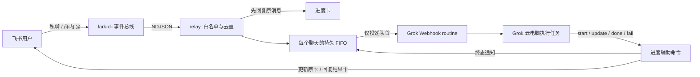

# Grok Bot ↔ 飞书

[](https://github.com/hjk41/grokbot-feishu-bridge/actions/workflows/test.yml)

用飞书私聊或群内 `@机器人` 给 **Grok Bot（Cursor 的云电脑代理）** 下达任务，并在飞书查看排队、执行阶段和结果。默认通过 Grok Bot 官方的 **Webhook routine** 唤起任务；通过官方 **lark-cli** 接收消息、回复和更新卡片。可选的 Mac 原生审批和聊天隔离功能读取本人已登录客户端的认证文件，详见[运行说明](docs/operations.md)。

**状态：可复用的实验性参考实现，MIT 开源。** 支持同一工作区 `full` 模式，以及 Linux/macOS 独立入口 `inbound` + 云端 `cloud-worker` 模式。独立入口持有队列、卡片和心跳，云端通过带任务认证的 HTTPS 回调更新阶段与终态。入口主机必须持续在线；云端暂停仍可能延迟执行。

English: An experimental Feishu/Lark chat bridge for Cursor Grok Bot using webhook routines, durable per-chat queues, and reply-linked progress cards. Linux/macOS, Python standard library. Supports shared-workspace mode and independent ingress with authenticated cloud callbacks. See [architecture](docs/architecture.md) and [security](SECURITY.md).

## 工作流程



## 已实现

- 收到允许的文本消息后，先创建进度卡，再投递 routine；进度卡和结果卡都关联原消息。
- 每个聊天同时只有一个普通任务可投递；后续任务显示排队数量。不同聊天的队列独立。
- 任务、队列、投递声明写入磁盘；跨进程文件锁防止重复抢占和心跳覆盖终态。
- relay 每 12 秒刷新运行时间。阶段说明来自 Grok 显式调用辅助命令，不模拟内部工具事件。
- 完成、失败、超时后冻结原进度卡；结果或错误使用新的、关联原消息的卡片。
- 停止按钮只记录请求，原任务发起人才能操作；执行器须检查并配合停止。
- `/stop`、`/status`、`/help` 绕过普通 FIFO 投递给 routine；具体命令语义由 routine 执行。
- 卡片不显示模型名。内部兼容字段不代表已取得实际路由信息。
- 同一 CLI 总线上的两个消费者按顺序启动，保持 stdin 打开并等待 ready 标记；唤醒后可刷新连接。
- 同一状态目录仅允许一个 relay/补收进程；正常退出时关闭自己的事件消费者。
- 独立入口通过任务绑定的短期令牌接收 HTTPS 回调；云端执行者须先抢占，重复 webhook run 无法抢占已执行任务。
- 用户与聊天两层白名单，未配置时拒收；群消息必须明确提及配置的机器人 open_id。
- 保留同一聊天中明确引用的单条消息，按需通过 CLI 读取历史；入口不自动附加两次 @ 之间的聊天。
- 可选按聊天绑定独立原生 Grok Bot 对话，飞书仍使用同一个机器人；无共用入口自动降级。
- 可选 Mac 原生审批转发，支持本人单次允许/拒绝及 App 审批后的卡片同步。

## 部署

### 1. 准备运行环境

推荐在 **常开 Linux/macOS 主机** 部署独立入口，参见 [独立部署说明](nas-inbound/README.md) 与 [切流步骤](nas-inbound/CUTOVER.md)。需要 Python 3.10+、Bash、Node.js/npm 和 lark-cli。Python 代码仅使用标准库，使用 POSIX `fcntl` 文件锁，不支持原生 Windows。也可在 Grok Bot Linux 工作区用 `full` 模式共享状态。

```bash
git clone https://github.com/hjk41/grokbot-feishu-bridge.git
cd grokbot-feishu-bridge
npx @larksuite/cli@latest install
lark-cli --version
lark-cli config init
```

在引导中配置自己的飞书应用，启用机器人能力并发布版本。使用**专用 CLI 配置和运行用户**；不要与其他事件服务共用当前应用。应用需获准使用以下权限，并设置长连接事件订阅：

| 用途 | 权限 / 事件 |
| --- | --- |
| 私聊消息 | `im:message.p2p_msg:readonly` |
| 群内 @消息 | `im:message.group_at_msg:readonly` |
| 发消息和更新卡片 | `im:message:send_as_bot` |
| 读取消息 / 卡片事件辅助读取 | `im:message:readonly` |
| 消息事件 | `im.message.receive_v1` |
| 卡片按钮回调 | `card.action.trigger` |

具体权限要求以当前 `lark-cli event schema <事件名>` 和飞书控制台为准。配置、批准权限、发布应用、连接 ready、真正收发成功是不同的检查点。此桥接使用 `--as bot`，不需要 `im:message.send_as_user`，也无需为了接入而申请用户代发权限。参见 [官方 CLI 安装和认证说明](https://github.com/larksuite/cli)。

### 2. 创建 Grok Webhook routine

让 Grok Bot 创建一个 Webhook 触发的 routine。独立入口使用 [cloud-worker 指令模板](prompts/standalone-routine.md)，云端只需 `relay/worker_progress.py`。同一工作区则使用 [full 模式模板](prompts/feishu-routine.md)，将其中的 `PROJECT_DIR` 替换为实际路径。

在桌面客户端打开 routine，复制 **POST to** URL 与 **key**。官方协议为 HTTP POST JSON，带 `Authorization: Bearer <key>`。HTTP 200 只表示接受并启动，完成情况需看 routine 历史与任务终态。参见 [官方 routine 文档](https://cursor.com/help/grok-bot/routines)。

配置秘密时使用 Grok 的安全 secret 输入或直接编辑受保护的本地配置；不要把密钥粘到普通聊天或 prompt 模板。

### 3. 配置白名单与 Webhook

```bash
cp .env.example .env
chmod 600 .env
# 使用自己的编辑器填写 .env
```

必填：

| 配置 | 含义 |
| --- | --- |
| `FEISHU_ALLOWED_USERS` | 允许下达任务的 open_id，多个值用逗号分隔 |
| `FEISHU_ALLOWED_CHATS` | 允许接收指令的 chat_id，多个值用逗号分隔 |
| `FEISHU_RELAY_WEBHOOK_URL` | routine 的 HTTPS POST 地址 |
| `FEISHU_RELAY_WEBHOOK_KEY` | routine 密钥 |
| `FEISHU_BOT_OPEN_ID` | 群内 @消息识别需要；填机器人 open_id，不能填 app_id |
| `FEISHU_BIN` | CLI 可执行文件名或完整路径，默认 `lark-cli` |
| `RELAY_ROLE` | 独立入口用 `inbound`；共享状态用 `full`；无效值拒绝启动 |
| `BRIDGE_PUBLIC_URL` | `inbound` 必填：反向代理到 loopback 回调服务器的 HTTPS 基址 |
| `FEISHU_PROFILE` / `LARK_CLI` | 专用 CLI profile / 实际 CLI 路径，避免改变其他应用配置 |
| `PYTHON_BIN` | Python 路径；macOS 请使用已安装的 Python 3.10+ |

获取自己环境的 ID，可在控制台/通讯录查看，或在受保护的终端进行一次有界监听：

```bash
lark-cli event consume im.message.receive_v1 --as bot --max-events 1 --timeout 60s
```

随后从自己的飞书账号向机器人发一条测试消息。输出中的 `sender_id` 和 `chat_id` 填入白名单。群消息 `mentions[].id` 可识别机器人。输出含聊天内容与身份数据，请不要贴进公开 issue。白名单无通配符；空列表不接受任何人。

### 4. 启动和验收

```bash
bash scripts/run.sh
```

先以前台方式验收，再决定是否使用 `nohup bash scripts/run.sh > relay/relay.log 2>&1 &`。`nohup` 不能防止云电脑暂停或恢复/更新后进程消失。

1. 查看日志，确认两个事件消费者 ready 和同一总线正常。
2. 飞书发送“查看当前工作目录，不修改文件”：应先收到进度卡，再收到关联原消息的结果卡。
3. 连发三条短任务：同一聊天仅队首投递，后续卡显示等待；队首终态后再派发下一条。
4. 完成后等待两个心跳周期：原卡时间和终态应保持不变；所有卡都不显示模型名。
5. 可用一个无副作用的长任务检验停止请求；卡片显示停止请求不等于进程已被强制取消。

新部署必须自行完成这些验收；仓库测试使用模拟传输，不代替真实飞书/Grok 收发。

## Grok 如何更新卡片

独立入口的 routine 使用收到的完整 payload 调用 `worker_progress.py`，例如 `python3 relay/worker_progress.py update --payload worker-runs/UNIQUE_RUN/payload.json --action '整理结果'`。每个 run 使用独立受保护文件，先 `start` 抢占成功，再执行请求，最后 `done` 或 `fail`；详见 [模板](prompts/standalone-routine.md)。

同一工作区 `full` 模式根据 payload 中的 `task_id` 调用以下命令：

```bash
bash scripts/progress.sh start --task-id TASK_ID --action '检查环境'
bash scripts/progress.sh update --task-id TASK_ID --action '整理结果' --detail '已完成检查'
bash scripts/progress.sh show --task-id TASK_ID
bash scripts/progress.sh done --task-id TASK_ID --summary '检查完成，结果如下……'
# 失败时：
bash scripts/progress.sh fail --task-id TASK_ID --error '任务失败原因'
```

`done --summary` 和 `fail` 负责结果/错误卡，不要再手动发送第二份。`show` 可查看 `stop_requested`。`relay/list_pending.py` 只列出可执行 pending；`relay/archive_pending.py` 只归档该目录里的单个 JSON。不要扫描历史文件重新执行已结束任务。

## 测试与隐私检查

```bash
python3 -m unittest discover -s relay/tests -v
python3 scripts/audit_public_tree.py
```

测试覆盖原消息关联、FIFO、两个进程争抢、终态冻结、阶段更新、停止权限、白名单、归档、模型页脚隐藏，以及真实 loopback HTTP 的认证、执行抢占和终态重试。全程不需要真实账号或密钥。公开树审计可检查工作树或 Git 中全部已跟踪历史：`--git-history`。审计是辅助检查，不能证明不存在任何形式的私人信息。

## 已知边界

- **入口离线会停止收件。** `full` 模式随云电脑暂停；`inbound` 模式依赖入口主机在线和公网回调可达。macOS 登录代理在注销、关机或合盖休眠时会中断，不能据此保证全天候服务。见 [运行说明](nas-inbound/CUTOVER.md) 和 [Cursor 官方空闲暂停说明](https://forum.cursor.com/t/grok-bot-computer-freezes-reboots-repeatedly-and-kills-24-7-background-scripts/174272)。
- **独立部署需要双向 HTTPS。** 入口访问 Grok webhook，云端访问入口回调；未配置回调或 routine 仍用旧 helper 时无法完成终态推进。见 [架构说明](docs/architecture.md)。
- **不是 exactly-once。** 持久抢占避免并发重复派发，但超时重试可能重复 HTTP 请求，进程在抢占后退出也可能留下未投递任务。不要自动重复有副作用操作。
- 队列等待不计启动超时；已接受但未启动默认 10 分钟超时，阶段长期不更新默认 30 分钟超时。超时卡不代表底层执行已停止，下一任务可能与旧执行重叠。
- 初版只接受文本指令；图片、附件、语音和审批确认流程没有实现。`/new`、`/history` 未提供专门状态管理。
- 权限白名单保护消息入口，不能隔离 Grok 云电脑上的账号、文件或其他 Bot。提示词中的审批规则也不是强制执行的安全沙箱。

排错见 [运行手册](docs/operations.md)。提交 issue 或 PR 前请读 [隐私与安全](SECURITY.md) 和 [贡献说明](CONTRIBUTING.md)。本项目与 Cursor、xAI、飞书及 cc-connect 均无官方从属关系；不包含它们的产品代码。
