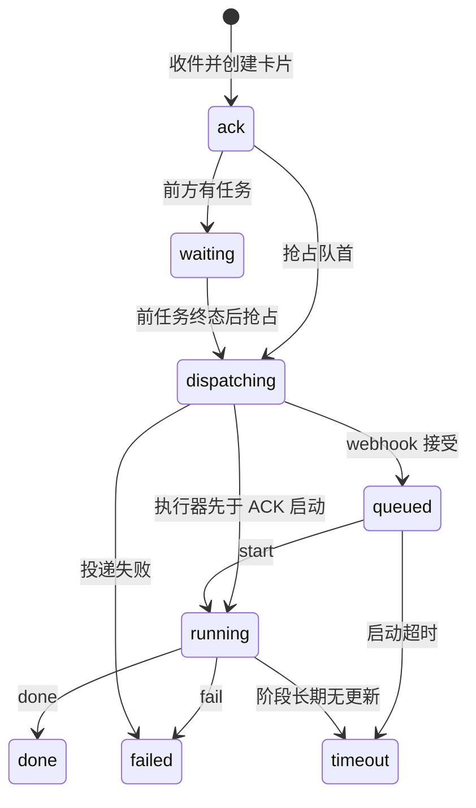

# 架构与协议

## 入口与队列

`relay.py` 消费 lark-cli 输出的**扁平 NDJSON**，不是直接处理飞书原始 webhook envelope。修改 CLI 版本时先检查 `event schema`；不要把原始飞书 HTTP payload 直接传给 `on_message`。

消息在身份、聊天、消息类型和群内明确 @检查通过后，按原 message_id 去重。先保存任务并回复进度卡，再入队，避免扫描线程删掉尚未创建的任务。只有队首能在聊天锁→任务锁顺序下持久抢占，然后释放锁进行网络 POST。阶段命令仅写终态和推进通知，下一条派发由 relay 执行。

状态机：



`done`、`failed`、`timeout` 冻结卡片；晚到的心跳或 webhook ACK 不可回退状态。停止请求是一项独立标记，不是终态。超时没有底层强制取消能力，因此“单个队首”不等同于“所有真实执行永远不重叠”。

## Webhook payload 示例

以下都是虚构值。标识符来自部署者自己的飞书应用。

```json
{
  "kind": "message",
  "event_id": "event_example",
  "message_id": "om_example",
  "chat_id": "oc_example",
  "chat_type": "p2p",
  "sender_open_id": "ou_example",
  "sender_type": "user",
  "msg_type": "text",
  "text": "查看工作目录，不修改文件",
  "task_id": "example_task",
  "progress_message_id": "om_progress_example",
  "queue_position": 0,
  "executable": true
}
```

实际还有原消息关联字段、执行说明等。`task_id` 用原 message_id 的 SHA-256 前 16 位生成，重收同一消息不会另建卡。传输身份由 Webhook bearer key 验证；payload 中的用户 ID 本身不是独立的密码。

## 文件职责

| 文件 / 目录 | 职责 |
| --- | --- |
| `relay.py` | 事件接收、授权、投递、唯一心跳、连接恢复与队列扫描 |
| `settings.py` | 入口白名单、消息类型、群 @身份、配置校验 |
| `progress.py` | Card 2.0 构建、CLI API 传输、任务锁和阶段命令 |
| `chat_queue.py` | 聊天 FIFO、持久抢占、重启恢复和终态推进 |
| `model_resolve.py` | 保留兼容的内部元数据验证；公开模型页脚关闭 |
| `tasks/` | 任务与进度状态、任务锁 / 聊天锁 |
| `queues/` | 每个聊天的队列及推进通知 |
| `pending/` | 已经可执行的 webhook 输入；等待任务不会写入这里 |
| `processed/` | 执行后归档的输入 |
| `seen_ids.txt` | 重启后消息去重记录 |

运行目录必须持久保存且不公开。源代码可以重新拉取，任务目录不可当作临时 build 输出清理。去重缓存保留最近 5000 项；它不是永远完整的消息数据库。

## 独立入口与云端回调

云电脑上的 relay 不能在云电脑暂停时唤醒自身。需要独立的常开 ingress：

1. 常开主机持久收件、授权、排队，立即通过飞书 API 回复进度卡。
2. ingress 通过 routine 的 webhook 唤起 Grok。
3. Grok 通过 HTTPS、任务绑定的认证回调上报阶段和终态；ingress 持有任务状态和卡片操作权限。
4. ingress 验证回调身份、task_id、状态迁移和防重放，结束后推进 FIFO。

`RELAY_ROLE=inbound` 启动 loopback HTTP 服务器（默认 8765），由 HTTPS 代理公开。
`full` 保留原共享状态行为；`cloud-worker` 不启动监听、扫描或心跳，直接退出。
云端 routine 只调用 `worker_progress.py`，不读取入口文件或直接操作飞书。

投递队首前持久保存随机任务令牌和 24 小时有效期，将 `callback.url` 与
`callback.token` 加入私有 webhook envelope。令牌只允许访问该 task，不能跨任务。
GET `/v1/tasks/<task_id>` 返回有限状态字段；POST 接受 `start/update/done/fail`。
全局凭据不随 payload 传输，服务器不记录请求路径、正文或认证 header。

云端每个 run 使用不同的 mode-600 payload 文件。第一次 start 前保存随机 worker_id，
入口持久抢占此 task；另一个 worker_id 的写入返回 409。相同 worker 的终态重试
不重复发卡，晚到 update 被拒绝。客户端拒绝 HTTP 和重定向；测试中只显式允许 loopback HTTP。
只有入口更新卡片和终态推进通知；现有 relay 扫描器完成下一任务派发。

公开 `/health` 仅表示回调服务器存活。凭据、任务状态、pending 和 worker-runs
不能被静态文件服务器公开；不要通过公网共享状态目录。抢占不能保证崩溃后的
副作用 exactly-once，终态发送期间崩溃也可能留下缺失的结果卡，需人工核对。
